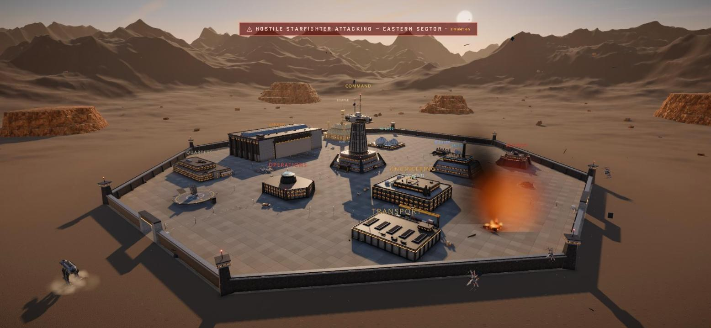
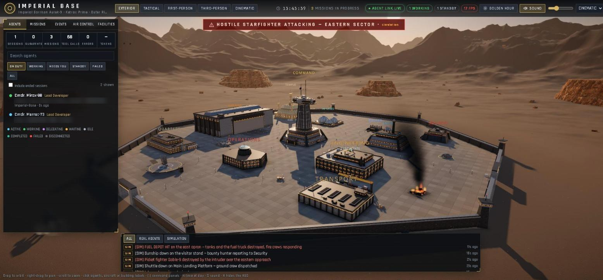

# Imperial Base

**A living 3D garrison where your real Claude Code agents show up as personnel at work.**



[](https://react.dev)
[](https://threejs.org)
[](https://fastapi.tiangolo.com)
[](#privacy-and-security)
[](LICENSE)

Imperial Base turns your coding agents into something you can watch. Every Claude Code session on your machine
appears as an officer in **Imperial Garrison Aurek-9 on Ketrax Prime**: they walk to the department that matches
their work, stand at a console while a tool runs, and flag you down when they need a permission. Around them the
base lives its own life: shuttles land, fighter patrols launch, a walker patrols the wall and an intruder makes
a strafing run.

You can also give orders. Type a task into the Orders chat and a Claude Code agent carries it out in this
project's folder, and you watch it walk into the base and get to work.

Everything runs on your own computer. No cloud services, no paid APIs, no Docker.

---

## Contents

- [Features](#features)
- [Quick start](#quick-start)
- [Connect your agents](#connect-your-agents)
- [Using the base](#using-the-base)
- [What is real and what is simulated](#what-is-real-and-what-is-simulated)
- [Configuration](#configuration)
- [Development](#development)
- [Project layout](#project-layout)
- [Privacy and security](#privacy-and-security)
- [Documentation](#documentation)
- [Credits and disclaimer](#credits-and-disclaimer)
- [License](#license)

## Features

- **Live agents.** Sessions, subagents and their parent/child links, the active tool, errors, token use and
  turn summaries, all from Claude Code's supported hooks. Cursor sessions are reported too.
- **"Needs you" alerts.** A banner, a pulsing top-bar pill and the browser tab title tell you when an agent is
  waiting for a permission or a turn has failed. One click takes you to it.
- **Orders.** A chat that starts headless Claude Code agents in this project's folder, up to four at once.
- **A world to explore.** Eight division buildings, a command tower with a working holo table, an underground
  server bunker showing your machine's CPU and memory, and interiors you can walk into.
- **Five camera modes.** Free orbit, tactical map, first person, third person and cinematic tours.
- **Ambient story.** Shuttle landings, fighter patrols, an X-wing attack, a freighter escape, a walker patrol,
  a parade march and a lightsaber duel, all clearly marked as simulation.
- **Look and sound.** Golden hour, dusk and night lighting; AgX tone mapping with a colour-grade LUT; cascaded
  sun shadows; four quality presets; optional procedural sound with Doppler.

## Quick start

**Requirements:** Windows 10 or 11, [Node.js](https://nodejs.org) 20 or newer,
[Python](https://www.python.org) 3.11 or newer, and [Claude Code](https://claude.com/claude-code).

```bat
git clone https://github.com/computedocean/Imperial-Base.git
cd Imperial-Base
start.cmd
```

On first run `start.cmd` creates the Python environment, installs dependencies and builds the frontend. It then
serves the app at **http://127.0.0.1:8742** and opens your browser.

To stop it, run `stop.cmd` or press Ctrl+C in the server window. `stop.cmd` ends only what `start.cmd` or
`dev.cmd` left listening on ports 8742 and 5273.

## Connect your agents

The base runs without any setup and shows *HOOK NOT INSTALLED* until you connect Claude Code. Connecting adds one
hook to your global Claude Code settings, so it is a step you run yourself:

```bat
python scripts\install_hooks.py              :: install
python scripts\install_hooks.py --status     :: check
python scripts\install_hooks.py --uninstall  :: remove
```

The installer only adds its own entries and leaves your other hooks untouched. Running it twice changes nothing,
and it writes a timestamped backup (`settings.json.bak-imperial-*`) before every change. New Claude Code sessions
report to the base from then on; sessions already running pick it up when restarted.

To try it for one session without touching global settings, pass the hook on the command line:
`claude --settings <file-with-the-hooks-block.json>`. See [Agent integration](docs/AGENT_INTEGRATION.md).

## Using the base



### Controls

| Key or action | Effect |
|---|---|
| `1` Exterior | Free orbit camera: drag to orbit, right-drag to pan, wheel to zoom |
| `2` Tactical | Top-down map with building labels, agent beacons and aircraft |
| `3` First person | Click to lock the mouse; `WASD` to move, `Shift` to run, `E` at doors, `Esc` to release |
| `4` Third person | A commander avatar: `WASD`, drag to turn the camera, wheel to zoom, `E` at doors |
| `5` Cinematic | Automated tours: flyover, shuttle arrival, hangar, command chamber, server bunker, agent activity |
| `H` / `L` | Hide the HUD / toggle building labels |
| `N` | Cycle the time of day: golden hour, dusk, night |
| `S` or **SOUND** | Sound on or off, with a volume slider. Off by default |
| Click | Agents, aircraft and building labels open the inspector; **Follow** attaches the camera |

Quality (LOW, MEDIUM, HIGH, CINEMATIC) is chosen in the top bar. Sound, quality and time of day are remembered
per browser.

### Panels

| Tab | What it does |
|---|---|
| **Agents** | The roster with filters (working, needs you, standby, failed) and per-agent details |
| **Missions** | Every task, plus the **Orders** chat at the bottom |
| **Events** | The raw event stream |
| **Air Control** | Shuttle arrivals and departures, fighter patrols, the X-wing attack, hangar doors, the freighter escape, the walker patrol and the lightsaber duel |
| **Facilities** | View or walk into Command, Hangar, Intelligence, Engineering, Operations, AI Labs, Security and the Server Bunker; start any cinematic tour |

### Orders

Type an order and a Claude Code agent carries it out in the Imperial Base folder, and nowhere else.

- Each conversation is one agent. Up to four work at once.
- You can reply once an agent has finished its turn, or stop it while it works.
- File edits go through. Any other action your Claude Code settings do not already allow is refused and
  reported in the chat.
- Conversations are kept in memory only and are gone when the server stops.
- Set `IMPERIAL_ORDERS=0` to switch orders off.

## What is real and what is simulated

| Real (from Claude Code and Cursor hook events) | Simulated scenery |
|---|---|
| Agents, sessions, subagents, parent/child delegation | Shuttle, TIE fighters, X-wing, interceptors, the shoot-down |
| Status, active tool, tool target (sanitised), errors | Impounded freighter, heavy walker, lightsaber duel |
| Permission waits and failed turns | Decorative personnel: troopers, crew, officers |
| Assignments (short prompt and delegation excerpts) | Hangar doors, beacons, dust |
| Task history and completion summaries | |
| Token usage and model id, read after each turn | |
| Host CPU, memory, GPU availability and Docker status | |

Real agents wear black uniforms with gold epaulettes, stand on a pulsing status ring, carry a **LIVE AGENT**
nameplate and appear in the roster. Decorative personnel have none of these. Feed items are tagged **AGENT** or
**SIM**. If an agent has sent no event for 15 minutes, its activity reads *unknown* with the time of the last
confirmed event, rather than a guess.

## Configuration

All settings are optional environment variables, read when the server starts.

| Variable | Default | Purpose |
|---|---|---|
| `IMPERIAL_PORT` | `8742` | Port the server listens on |
| `IMPERIAL_HOST` | `127.0.0.1` | Address to bind. Keep it on loopback |
| `IMPERIAL_BASE_DIR` | `%USERPROFILE%\.imperial-base` | Where the hook's spool file lives |
| `IMPERIAL_SPOOL` | `<base dir>\spool\events.jsonl` | The spool file itself |
| `IMPERIAL_DB` | `backend\data\imperial.db` | SQLite event store |
| `IMPERIAL_STALE_AFTER` | `900` | Seconds without events before an agent's activity reads *unknown* |
| `IMPERIAL_MAX_EVENTS` | `50000` | Events kept in the database |
| `IMPERIAL_READ_USAGE` | `1` | Read token counts and model id from transcripts. `0` turns it off |
| `IMPERIAL_ORDERS` | `1` | Enable the Orders chat. `0` turns it off |
| `IMPERIAL_ORDERS_CWD` | this project | The only folder order agents work in |

## Development

```bat
dev.cmd      :: backend with --reload on :8742, plus Vite hot reload on http://127.0.0.1:5273
test.cmd     :: pytest, vitest and the TypeScript typecheck
```

- Asset previews: `http://127.0.0.1:5273/?preview=aircraft` and `?preview=personnel`.
- After changing frontend code, rebuild for `start.cmd` with `cd frontend && npx vite build`
  (`start.cmd` also rebuilds when it detects stale output).
- The 3D models are built by Python scripts for Blender in `tools/blender/`. See its
  [README](tools/blender/README.md).

See [Testing](docs/TESTING.md) for what each suite covers.

## Project layout

```
backend/          FastAPI server: hook ingestion, state engine, SQLite store, Orders, WebSocket
  app/            main.py (routes), engine.py, state.py, store.py, orders.py, system.py, config.py
  tests/          pytest suites
frontend/         React + React Three Fiber client
  src/            world, aircraft, vehicles, personnel, agents, interiors, camera, audio, ui, state
  public/models/  compressed glTF models
hooks/            imperial-hook.js, the Claude Code capture hook
scripts/          hook installer, stop script, build helpers
tools/blender/    Blender scripts that build the models
docs/             design and reference documentation
```

## Privacy and security

- **Loopback only.** The server binds to `127.0.0.1`. WebSocket and order requests from other sites are
  refused by checking the caller address, Host and Origin.
- **The hook keeps little.** It never stores tool inputs or outputs, file contents, full commands or full
  prompts. File tools are reduced to the file name, prompts to a short redacted excerpt, and secrets such as API
  keys, tokens and e-mail addresses are redacted before anything is written.
- **Defence in depth.** The backend accepts only an allow-list of fields and truncates strings again.
- **One command channel.** Sessions started elsewhere are observed only. Orders reach only the agents the base
  starts itself, in its own folder.

Details: [Agent integration](docs/AGENT_INTEGRATION.md) and [Security policy](SECURITY.md).

## Documentation

| Document | Contents |
|---|---|
| [Architecture](docs/ARCHITECTURE.md) | Components, data flow and process model |
| [Agent integration](docs/AGENT_INTEGRATION.md) | Hook capture, privacy, lifecycle mapping, department assignment, Orders |
| [Event schema](docs/EVENT_SCHEMA.md) | Hook payloads, the sanitised record format and the HTTP and WebSocket API |
| [Aircraft simulation](docs/AIRCRAFT_SIMULATION.md) | Flight paths, the landing sequence, patrols and clearance guarantees |
| [World design](docs/WORLD_DESIGN.md) | Planet, terrain, layout and art direction |
| [Department design](docs/DEPARTMENT_DESIGN.md) | Every facility and interior, and which tools map to which station |
| [Performance](docs/PERFORMANCE.md) | Budgets, quality presets and measurements |
| [Testing](docs/TESTING.md) | Test suites and how each feature was verified |
| [Implementation status](docs/IMPLEMENTATION_STATUS.md) | Feature checklist, change log and known limitations |
| [Build notes](docs/SKILL_INVENTORY.md) | The capability assessment made at the start of the project |

Contributions are welcome: see [Contributing](CONTRIBUTING.md).

## Credits and disclaimer

Imperial Base is an unofficial fan project. It is not affiliated with, endorsed by or sponsored by Lucasfilm Ltd.
or The Walt Disney Company. Star Wars and related names are trademarks of their respective owners. The aircraft,
vehicles and buildings are original designs *inspired by* the genre, not copies of film assets.

- 3D models: original, built with the Blender scripts in `tools/blender/` and procedural geometry in code.
- Desert boulders: photo-scanned rocks from [Poly Haven](https://polyhaven.com) (CC0).
- The march leader figure was generated with an AI 3D model generator and finished in Blender.
- Textures and sound are generated in code. No copyrighted music, textures or sound effects are used.

## License

[MIT](LICENSE) © 2026 Michael Dallman
